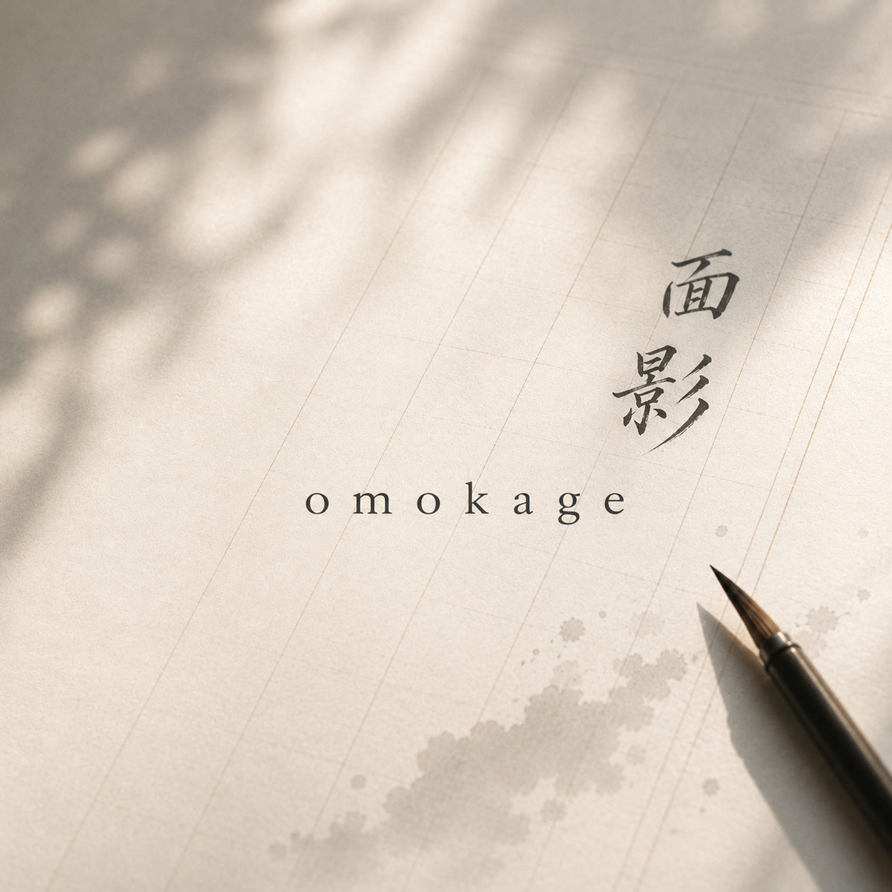
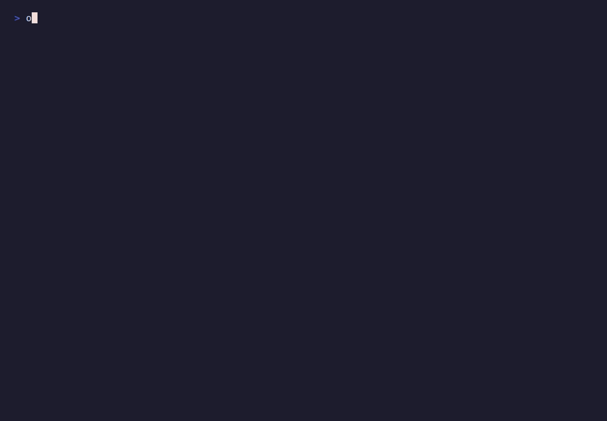
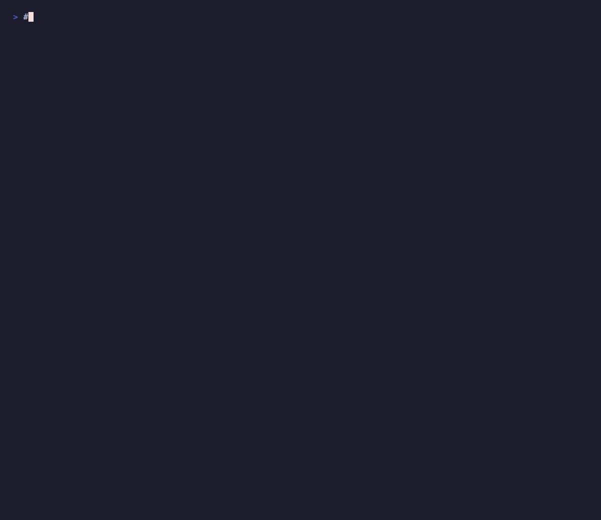

<!-- ALL-CONTRIBUTORS-BADGE:START - Do not remove or modify this section -->
[](#contributors-)
<!-- ALL-CONTRIBUTORS-BADGE:END -->
[](https://github.com/nao1215/omokage/actions/workflows/unit_test.yml)
[](https://github.com/nao1215/omokage/actions/workflows/e2e_test.yml)
[](https://github.com/nao1215/omokage/actions/workflows/build.yml)

[](https://github.com/nao1215/omokage/actions/workflows/gitleaks.yml)
[](https://github.com/nao1215/omokage/actions/workflows/trivy.yml)
[](https://github.com/nao1215/omokage/actions/workflows/govulncheck.yml)
[](https://github.com/nao1215/omokage/actions/workflows/gosec.yml)
[](https://github.com/nao1215/omokage/actions/workflows/reviewdog.yml)
[](https://github.com/nao1215/atago)
[](https://github.com/nao1215/himorime)
[](https://pkg.go.dev/github.com/nao1215/omokage)
[](https://github.com/nao1215/omokage/releases)
[](./LICENSE)
[](https://scorecard.dev/viewer/?uri=github.com/nao1215/omokage)

<p align="center">
  
</p>

omokage learns how you write from your past writing, then scores how close a new draft is to that style. It runs locally, works on Japanese and English, and never uses the network.



A high score means the draft reads like the voice you trained. It says nothing about meaning, correctness, or quality.

## Install

```shell
go install github.com/nao1215/omokage@latest
```

On Arch Linux, [`omokage-bin`](https://aur.archlinux.org/packages/omokage-bin) is community-maintained and installs the release binary:

```shell
yay -S omokage-bin   # or: paru -S omokage-bin
```

Runs on Windows, macOS, and Linux. Building from source needs Go 1.26.6 or later.

## Quick start

The repo ships a small example corpus under [examples/](./examples) to follow along.

```shell
$ omokage init                                   # writes omokage.toml, profiles/, cache/
$ omokage train --author me examples/en/posts    # learn a voice from .md/.txt files
Trained author "me" from 8 files.
Profile: /home/me/blog/profiles/me.db

Corpus reliability: good.
$ omokage check examples/en/draft-keeps-voice.md  # score a draft (one profile needs no --author)
Author: me
Similarity: 92% (this author's self-similarity median 90%, range 75-91%)

Differences:
- character n-gram "gh" is higher than reference
- function word "at" is higher than reference
- character n-gram "ht" is higher than reference
```

`train` takes directories (scanned for `.md`/`.txt`) and files, and reads local files only. A URL, a missing path, or an unsupported extension stops the run before anything is trained.

The same idea rewritten in a stiff, formal voice scores low:

```shell
$ omokage check --author me examples/en/draft-lost-voice.md
Author: me
Similarity: 0% (this author's self-similarity median 90%, range 75-91%)

Differences:
- average sentence length is higher than reference
- paragraph length variance is higher than reference
- sentence length variance is higher than reference
```

`omokage diff A B` compares two files directly, without training a profile.

## Checking a corpus

Aim for eight or more documents, each a few paragraphs long, in one voice. `doctor` rates a corpus without training and names what to fix:

```shell
$ omokage doctor ~/drafts
Corpus: 3 documents, 9 sentences, 140 characters (avg 46 per document)
Reliability: weak

Findings:
- [warning] Only 3 documents. The measured spread is barely an estimate, so scores will be noisy.
    → Add more samples of this voice; 8 or more documents give steadier scores.
- [warning] 3 of 3 documents are short (under 150 characters).
    a.md, b.md, c.md
    → Short samples make per-document features jumpy; prefer samples of a few paragraphs.

These checks look at sample size and consistency, not writing quality.
```


`doctor --format json` returns the same report as data, and `train` prints the rating too. If a corpus mixes voices, split it into one profile per voice.

## Choosing the author

`--author` is a profile name, so it can name a purpose (`--author blog`). Without it, `check` and `show` use `default_author`, then the only profile, and otherwise fail. Set a default with `train --author me --default ...`.

## Output modes

| Mode | Output | For |
| --- | --- | --- |
| (default) | similarity score + top differences | quick, human-facing checks |
| `--score-only` | the integer 0-100 | shell pipelines, pass/fail gates |
| `--explain` | per-feature drift (value, mean ± spread, z-score) + the paragraphs that drift most | final by-hand tuning |
| `--format json` | the `--explain` detail as JSON, plus `term_warnings` | an LLM or tool reading between rewrites |

`--explain` and `--format json` are slower because they score each paragraph. `--score-only` can't be combined with them.

```shell
$ score=$(omokage check --score-only draft.md)
$ [ "$score" -ge 70 ] && echo "close enough"

$ omokage check --author me --explain examples/en/draft-lost-voice.md
Author: me
Similarity: 0% (this author's self-similarity median 90%, range 75-91%)
Score driver: lexical
Scoring note: This score is computed from the full fingerprint and structure mix; the paragraph-level scalar drift below is supporting detail and usually contributes less than the lexical fingerprint.

High-level style differences (fix these first):
  1. average sentence length is higher than reference [structure]
       target 292.3  reference 40.4 ± 1.540  (62.3σ)
  ...

Typical paragraph drift (median): 18.7σ
Paragraphs that drift most:
  #2 (74.9σ; average sentence length higher): Subsequently, a notebook is utilized for the purpo…
```



## Using omokage with an LLM

Have the agent run `check --format json` after each rewrite and revise until the score rises. `high_level_drift` lists the features to edit, each with a `priority` and an `actionable` flag, and `segments` points at the paragraphs that drift most. `segment_style_drift` is informational and does not affect the score.

`train` also learns which form you use for a recurring term (`DB` or `データベース`, `HTTP` or `http`). Case and full/half-width ASCII are folded, so `DB`, `db`, and `ＤＢ` count as one term, and a Japanese phrase joins its acronym only when the corpus writes both (`データベース（DB）`). The JSON output of `check` flags other forms under `term_warnings`; `show --format json` lists the learned ones under `term_preferences`, and `--summary` leaves them out.

## Managing profiles and stores

```shell
$ omokage list [--long]                # names, or trained_at / file count / source(s)
$ omokage show --author me             # how a profile was trained (--format json for more)
$ omokage rename --author me --to watashi
$ omokage remove --author watashi
```

omokage uses the nearest `omokage.toml` above the current directory. `omokage init --global` makes a per-user store under `$OMOKAGE_HOME` (or your user config dir) for directories without one. `--config PATH` / `--profile-dir PATH` point at a specific store.

## How it scores

Training stores the mean and spread of each feature in a SQLite database under `profiles/`, one per author, plus the surface forms of recurring terms; it does not store the documents. The features are register (敬体 / 常体), kanji/hiragana/katakana balance, function words, character n-grams, and sentence and paragraph shape. A check scores how far the draft strays from that range, as z-scores in the spirit of Burrows's Delta; the function-word and n-gram fingerprint carries most of the weight. The 0-100 score is calibrated against the profile's leave-one-out self-similarity, so retrain older profiles to get it. Code blocks are stripped first. Japanese text is split into morphemes with kagome. `pos_ngram_frequency` and `type_token_ratio` are off by default because they did not help on a held-out author-attribution test.

Few short documents give noisy scores. Japanese authors separate more sharply than English ones, and two people who write in the same register look more alike than they are. omokage is not an AI-text detector.

## About the name

omokage (面影) is written with 面 (face) and 影 (shadow, trace): the remembered image of someone, the likeness that comes back to mind. The name is borrowed from [Omokage](https://www.toraya-group.co.jp/products/collections/yokan-omokage), a yokan by Toraya that I like.

## Verifying release integrity

From v0.6.3 on, releases include a keyless [cosign](https://github.com/sigstore/cosign) signature of `checksums.txt` (`checksums.txt.sigstore.json`), an SPDX SBOM per archive (`<archive>.sbom.json`), and SLSA provenance (`multiple.intoto.jsonl`).

```shell
cosign verify-blob \
  --bundle checksums.txt.sigstore.json \
  --certificate-identity-regexp 'https://github.com/nao1215/omokage/\.github/workflows/release\.yml@refs/tags/.*' \
  --certificate-oidc-issuer 'https://token.actions.githubusercontent.com' \
  checksums.txt
grep ' omokage_<version>_<os>_<arch>.tar.gz$' checksums.txt | sha256sum --check
```

Check the provenance with the GitHub CLI or [slsa-verifier](https://github.com/slsa-framework/slsa-verifier):

```shell
gh attestation verify omokage_<version>_<os>_<arch>.tar.gz --repo nao1215/omokage
```

```shell
slsa-verifier verify-artifact omokage_<version>_<os>_<arch>.tar.gz \
  --provenance-path multiple.intoto.jsonl \
  --source-uri github.com/nao1215/omokage \
  --source-tag v<version>
```

## Testing

Unit, end-to-end, regression, property-based, metamorphic, fuzz, and mutation tests plus benchmarks are described in [doc/testing.md](doc/testing.md).

## Contributors ✨

Thanks goes to these wonderful people ([emoji key](https://allcontributors.org/docs/en/emoji-key)):

<!-- ALL-CONTRIBUTORS-LIST:START - Do not remove or modify this section -->
<!-- prettier-ignore-start -->
<!-- markdownlint-disable -->
<table>
  <tbody>
    <tr>
      <td align="center" valign="top" width="14.28%"><a href="https://debimate.jp/"><br /><sub><b>CHIKAMATSU Naohiro</b></sub></a><br /><a href="https://github.com/nao1215/omokage/commits?author=nao1215" title="Code">💻</a> <a href="https://github.com/nao1215/omokage/commits?author=nao1215" title="Documentation">📖</a></td>
      <td align="center" valign="top" width="14.28%"><a href="https://rafaeldominiquini.ddns.net/"><br /><sub><b>Rafael Baboni Dominiquini</b></sub></a><br /><a href="#platform-Dominiquini" title="Packaging/porting to new platform">📦</a></td>
    </tr>
  </tbody>
</table>

<!-- markdownlint-restore -->
<!-- prettier-ignore-end -->

<!-- ALL-CONTRIBUTORS-LIST:END -->

This project follows the [all-contributors](https://github.com/all-contributors/all-contributors) specification. Contributions of any kind welcome!

## License

MIT. See [LICENSE](./LICENSE).
